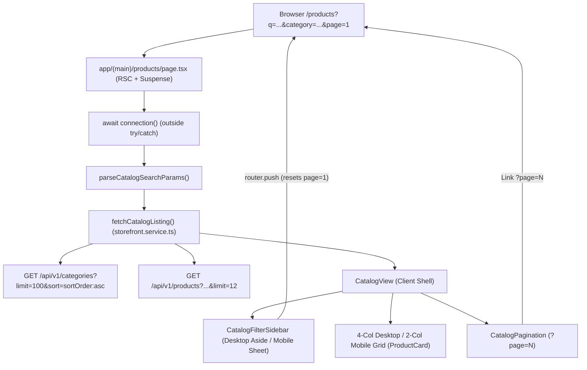

# SF-02 Product Catalog Listing, Filtering & ProductCard Design

## Overview & Context

This document specifies the architecture, URL contract, live API integration, and UI component design for Storefront **SF-02** (`#134`, split from `#46`, parent epic `#9`).

The existing route at `apps/storefront/app/(main)/products/page.tsx` currently reads static mock data from `getShowcaseCatalog()`. Wiring it to the live NestJS API (`GET /api/v1/categories` and `GET /api/v1/products`, specified in `#80` / `ADR-0025` and `#81` / `ADR-0027`) while reconciling the Stitch prototype (`danh_s_ch_s_n_ph_m.html`) and `docs/standards/ui-and-frontend.md` (`UI-1` through `UI-5`) surfaced five contract and layout mismatches that this design resolves:

1. **Route location**: `#134` references `apps/storefront/app/products/page.tsx`, whereas the active route inside `StorefrontShell` (`UI-2`) is `apps/storefront/app/(main)/products/page.tsx`.
2. **Unsupported sort keys**: The Stitch prototype exposes `featured` and `discount` sort options, which do not exist in `PRODUCT_SORT_OPTIONS` (`createdAt:desc`, `createdAt:asc`, `price:asc`, `price:desc`, `name:asc`, `name:desc`). `ListProductsQueryDto` uses `.strict()`, so sending unsupported keys triggers `400 VALIDATION_FAILED`.
3. **Absent category product counts**: `CategoryDto` does not include a `productCount` field. Displaying per-category counts from the prototype would require N+1 count queries or out-of-scope backend changes.
4. **ProductCard data & feedback alignment**: `ProductDto` provides `basePriceVnd`, `salePriceVnd`, `availableQuantity`, `unit`, `isVietGap`, `isUsda`, and `imageUrls`, without `origin` or `hoursRemaining` (Rescue Flash Sale `#61` is an explicit non-goal). Additionally, `UI-2` forbids triggering a redundant `toast` when the `MUA NGAY` button already transitions inline to a quantity stepper and updates the header cart badge.
5. **Missing pagination & mobile filter drawer**: `GET /api/v1/products` is paginated (`meta.total`, `meta.page`, `meta.limit`, `meta.totalPages`), whereas the prototype renders a static 8-item grid and stacks the filter sidebar above products on mobile.

### Goals

- Replace `getShowcaseCatalog()` on `/products` with live server-side reads against `GET /api/v1/categories` and `GET /api/v1/products` using generated OpenAPI types (`ADR-0007`) and server-only `api` client (`ADR-0036`).
- Support URL-driven search (`q`), 2-level category filtering (`category` -> `categorySlug`), certification filters (`vietgap`, `usda`), price-range presets (`price`), sorting (`sort`), and pagination (`page`, `limit=12`).
- Display a **4-column product grid on desktop** (`lg:grid-cols-4`, 2-column on mobile) alongside a `lg:col-span-3` filter sidebar on desktop and a `@greenroots/ui` `Sheet` filter drawer on mobile (`< lg`).
- Refactor the shared `ProductCard` (`apps/storefront/src/features/home/components/product-card.tsx`) to use a crisper, bordered card layout (`rounded-md`, clean white image container without green background tint, inline price + unit, discount percentage badge, live stock indicator) while preserving the existing primary `bg-brand-forest` CTA button color and Rescue Deal support for `SF-01`.

### Non-Goals

- Product detail view (`/products/[slug]`, sibling child from `#46`).
- Rescue Flash Sale countdown reservation (`#61`).
- Backend schema or DTO modifications (`apps/api` remains unchanged).
- Per-category `productCount` aggregation.

---

## Architecture & Data Flow

### Module & File Ownership

| File                                                                         | Responsibility                                                                                                                                                                                                            |
| :--------------------------------------------------------------------------- | :------------------------------------------------------------------------------------------------------------------------------------------------------------------------------------------------------------------------ |
| `apps/storefront/app/(main)/products/page.tsx`                               | Route entry, metadata (`title: "Sản phẩm"`), `<Suspense>` fallback (`ProductGridSkeleton`), calls `await connection()` before data fetching.                                                                              |
| `apps/storefront/src/services/catalog-query.ts`                              | Pure URL `searchParams` parser (`parseCatalogSearchParams`), URL builder (`buildCatalogHref`), price-preset map, sort-option whitelist, and 2-level category tree builder (`buildCategoryTree`).                          |
| `apps/storefront/src/services/storefront.service.ts`                         | Server-side `fetchCatalogListing` calling `GET /api/v1/categories` and `GET /api/v1/products` with injectable `deps` for offline unit tests.                                                                              |
| `apps/storefront/src/features/catalog/components/catalog-view.tsx`           | Main 2-column layout (`lg:grid-cols-12`: `lg:col-span-3` sidebar + `lg:col-span-9` grid), active result count (`meta.total`), sort `<Select>`, mobile `Sheet` filter trigger, empty state, error `Alert`, and pagination. |
| `apps/storefront/src/features/catalog/components/catalog-filter-sidebar.tsx` | 2-level category tree, `VietGAP` & `USDA Organic` `@greenroots/ui` `Checkbox` controls, price-range radio group, and filter reset action.                                                                                 |
| `apps/storefront/src/features/home/components/product-card.tsx`              | Shared `ProductCard` updated for both `SF-01` and `SF-02` (crisp `rounded-md` border, clean white `<Image>` slot, inline price/unit, `-X%` badge, stock status, existing `bg-brand-forest` CTA & stepper).                |

---

## URL SearchParams & API Mapping Contract

Every filter, sort, and page control is reflected in URL `searchParams` so views are bookmarkable and SSR-compatible.

| URL Param  | Allowed Values                                                        | API Query Param (`GET /api/v1/products`) | Sanitization / Default                                                                                                                                |
| :--------- | :-------------------------------------------------------------------- | :--------------------------------------- | :---------------------------------------------------------------------------------------------------------------------------------------------------- |
| `q`        | Non-empty string (max 100 chars)                                      | `q`                                      | Trimmed; omitted if blank; truncated to 100 chars.                                                                                                    |
| `category` | Kebab-case slug (`^[a-z0-9]+(?:-[a-z0-9]+)*$`)                        | `categorySlug`                           | Omitted if invalid slug format (prevents `400` from `.strict()` DTO). Never sends `categoryId` alongside `categorySlug` (`ADR-0025`).                 |
| `vietgap`  | `"true"`                                                              | `isVietGap: true`                        | Any other value is omitted.                                                                                                                           |
| `usda`     | `"true"`                                                              | `isUsda: true`                           | Any other value is omitted.                                                                                                                           |
| `price`    | `"under-25"` \| `"25-40"` \| `"over-40"`                              | `minPriceVnd` / `maxPriceVnd`            | `"under-25"` -> `maxPriceVnd: 24999`; `"25-40"` -> `minPriceVnd: 25000, maxPriceVnd: 40000`; `"over-40"` -> `minPriceVnd: 40001`; invalid -> omitted. |
| `sort`     | `"createdAt:desc"` \| `"price:asc"` \| `"price:desc"` \| `"name:asc"` | `sort`                                   | Invalid/unknown values fall back to `"createdAt:desc"`.                                                                                               |
| `page`     | Positive integer `>= 1`                                               | `page`                                   | Non-integer or `< 1` falls back to `1`.                                                                                                               |
| _(fixed)_  | `12`                                                                  | `limit: 12`                              | Divisible by 2 (mobile), 3 (tablet), and 4 (desktop) with bounded `ADR-0027` subquery cost.                                                           |

### Category Tree Construction

`GET /api/v1/categories` returns a flat paginated list (`ADR-0025`). `fetchCatalogListing` requests `limit: 100, sort: "sortOrder:asc"`, filters `isActive === true`, and `buildCategoryTree` groups rows into two levels:

- **Roots**: `parentId === null`, sorted by `sortOrder` ascending.
- **Children**: `parentId !== null`, attached to their matching root's `children[]` array (also ordered by `sortOrder`).
- Per-category counts are omitted because `CategoryDto` does not expose `productCount`.

### Filter Interaction Rules

- Changing `category`, `vietgap`, `usda`, `price`, or `sort` updates the URL via `router.push` and **resets `page` to `1`** (omitting `page=1` from the URL for cleanliness).
- Global `StorefrontHeader` search (`buildProductSearchHref`) navigates to `/products?q=...` as a fresh global search.
- Clicking `"Đặt lại"` / `"Xóa tất cả bộ lọc"` navigates to `/products` (clears all query params).

---

## Shared `ProductCard` Redesign (`SF-01` & `SF-02`)

Updating `apps/storefront/src/features/home/components/product-card.tsx` applies consistently across both `HomeView` (`SF-01`) and `CatalogView` (`SF-02`):

1. **Card Container**: `rounded-md border border-border-subtle bg-surface-card p-2.5 shadow-none transition-colors hover:border-brand-forest` (replacing heavy `rounded-xl` and `p-4` so 4 columns fit comfortably inside `lg:col-span-9` of `max-w-6xl`).
2. **Image Slot**: Clean white container (`bg-white`, `h-36`, `rounded-sm`, no `bg-green-50` tint). When `product.imageUrl` is present (already filtered against `remotePatterns` by `filterApprovedProductImages`), render Next.js `<Image>` with `fill` and `object-contain` (or `object-cover`). When absent, render the `Leaf` icon centered on `bg-surface-warm/40 border border-border-subtle/60`. Out-of-stock cards dim the image (`opacity-50`).
3. **Badges & Metadata**:
   - Top-left overlay on image (only when `product.isRescueDeal && product.hoursRemaining`): existing `HSD còn Xh` badge.
   - Certification / category micro-label (`VietGAP` / `USDA Organic` / child category) + live stock label (`Còn X <unit>` in `text-brand-forest`, or `Tạm hết hàng` in `text-light-on-surface-variant`, `tabular-nums`).
4. **Title & Pricing**:
   - Product name (`line-clamp-2` or `line-clamp-1`, `text-sm font-semibold text-gray-900`).
   - Inline effective price + unit (`49.000₫` + `/1 kg`, `tabular-nums`, `text-status-spoiled` for rescue deals or `text-brand-dark` otherwise).
   - When `hasMarkdown` (`salePriceVnd < basePriceVnd`): strikethrough `basePriceVnd` + compact discount pill `-${discountPct}%` (`bg-status-spoiled text-white rounded-sm px-1.5 py-0.5 text-[11px] font-semibold tabular-nums`).
5. **CTA & Stepper**:
   - **Preserve existing primary CTA color**: `bg-brand-forest text-white hover:bg-brand-dark` (`h-9 rounded-md text-xs font-semibold`).
   - Disabled `"Tạm hết hàng"` when `availableQuantity <= 0`.
   - Clicking `"MUA NGAY"` calls `useCartStore.addItem(product, 1)` and transitions inline to the `[- qty +]` stepper without firing a `toast` (`UI-2`).

---

## Error Handling, Resilience & `cacheComponents: true`

- **Next.js 16 `cacheComponents: true` (`UI-3`)**: `apps/storefront/app/(main)/products/page.tsx` wraps `<CatalogLoader searchParams={searchParams} />` in `<Suspense fallback={...}>`. Inside `CatalogLoader`, `await connection()` is called **first and outside any `try/catch`** before `searchParams` parsing and `fetchCatalogListing()`.
- **Partial Degradation**:
  - If `GET /api/v1/categories` fails or returns an error, `fetchCatalogListing` returns `categories: []` and still renders the product grid.
  - If `GET /api/v1/products` fails (network error or non-2xx response), `CatalogView` renders an inline `@greenroots/ui` `Alert` (`variant="destructive"`) with a localized message (`resolveSharedApiErrorMessage`) and a retry link, without leaking `error.message` or stack traces (`UI-4`).
- **Empty State**: When `products.length === 0` and no API error occurred, render a clean empty-state block with a `"Xóa tất cả bộ lọc"` button resetting to `/products`.

---

## Invariants (`StorefrontCatalogInvariants`)

- `INV-1`: `parseCatalogSearchParams` MUST sanitize every untrusted URL parameter (`q`, `category`, `vietgap`, `usda`, `price`, `sort`, `page`) so invalid slugs, negative/non-integer pages, or unknown sort keys never reach `GET /api/v1/products` and trigger `.strict()` `400` errors.
- `INV-2`: `buildCatalogApiQuery` MUST NEVER emit both `categoryId` and `categorySlug` simultaneously (`ADR-0025`), and MUST enforce `minPriceVnd <= maxPriceVnd` for every price preset.
- `INV-3`: `buildCategoryTree` MUST produce at most two levels (`parentId === null` roots and direct active children ordered by `sortOrder:asc`), omitting inactive categories (`isActive === false`).
- `INV-4`: `buildCatalogHref` MUST reset `page` to `1` (omitting `page=1` from the serialized query string) whenever any filter or sort parameter changes.
- `INV-5`: `ProductCard` MUST clamp rescue progress (`0..100`), disable purchasing when `availableQuantity <= 0`, and compute integer discount percentages only when `salePriceVnd < basePriceVnd`.

---

## Verification Plan

1. **Unit specs (`*.spec.ts`)** following `docs/standards/testing-and-fixtures.md` (`// Invariant: INV-N` above each `it()`):
   - `apps/storefront/src/services/catalog-query.spec.ts` covering `INV-1` through `INV-4` and `fetchCatalogListing` degradation paths.
   - Update `apps/storefront/src/components/common/ui-primitives-semantics.spec.ts` and `apps/storefront/src/services/home-catalog.spec.ts` if needed for `ProductCard` `INV-5`.
2. **Quality Gates**:
   - `bun run check` (type-check + lint across all workspaces).
   - `bun run test:storefront` (unit specs pass offline).
   - `bun --cwd apps/storefront run build` (verify `cacheComponents: true` + `<Suspense>` + `connection()` prerender/build).
